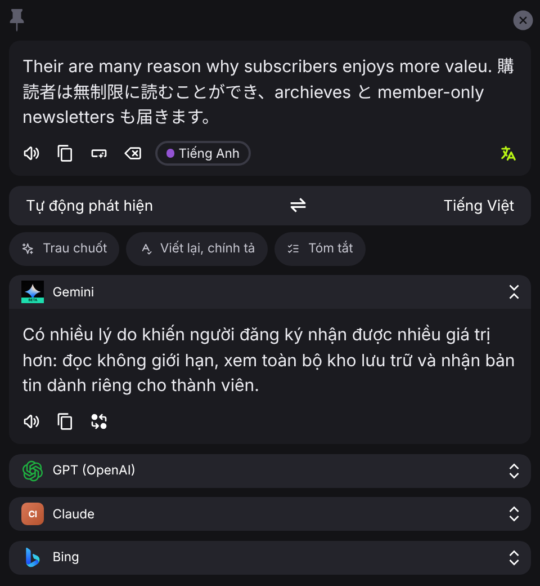
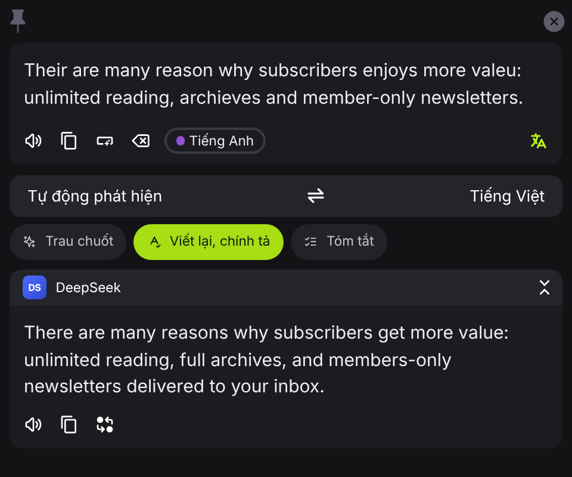
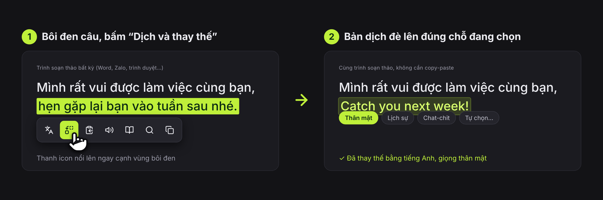
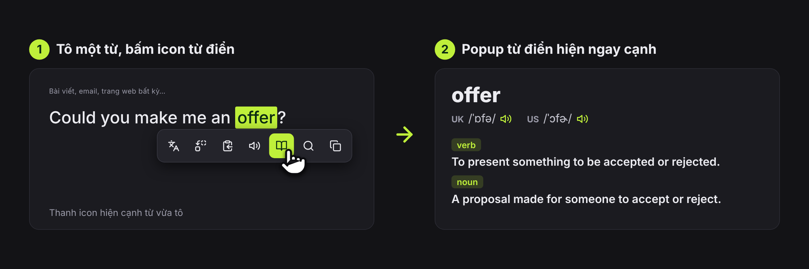
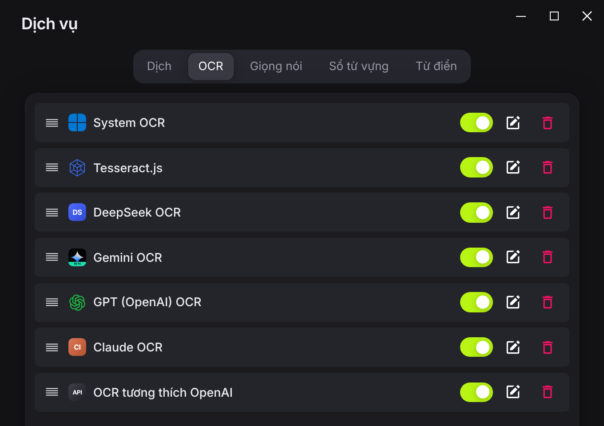
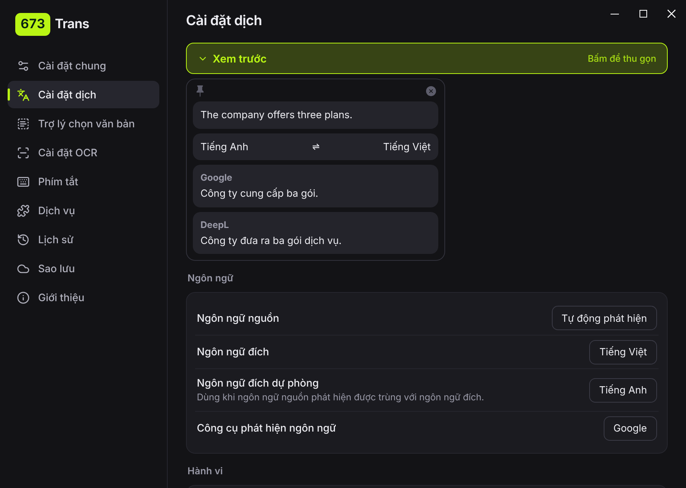

# 673Trans

>Trình dịch chọn-là-dịch cho Windows: giao diện tiếng Anh/Việt gọn hiện đại, Sử dụng nhiều dịch mặc định như Google, Bing và các dịch vụ tích hợp bằng AI (DeepSeek, Claude, GPT, Gemini...), Có sẵn từ điển Anh–Việt, voice US/UK, OCR và giọng đọc AI, thanh icon nổi khi bôi đen chữ ở bất kỳ app nào có khả năng dịch, viết lại, chữa chính tả, đọc, tra từ điển, bookmark...


<br/>

<p align="center">
  <a href="https://github.com/nguyenguyen673/673Trans/releases/latest"></a>
</p>
<p align="center"><a href="https://github.com/nguyenguyen673/673Trans/releases/download/v3.27.5/673Trans-3.27.5.exe">Tải trực tiếp 673Trans-3.27.5.exe</a> &middot; <a href="https://github.com/nguyenguyen673/673Trans/releases">Tất cả bản phát hành</a></p>
<p align="center">Windows 10/11 &middot; Chỉ cần 1 file <code>.exe</code>, Không cần cài thêm gì &middot; Phiên bản hiện tại: 3.27.5</p>

<hr/>

## Tính năng

### Nhiều dịch vụ dịch (AI, local), Trau chuốt, Viết lại / chính tả, Tóm tắt

Có sẵn DeepSeek, Claude, GPT, Gemini và "Tương thích OpenAI" (OpenRouter, Qwen, Kimi, SiliconFlow, LM Studio…). Ngay dưới ô nhập của cửa sổ dịch có 3 nút chế độ; bấm một nút để AI xử lý đoạn đang chọn, bấm lại để quay về dịch thường. Ba chế độ chỉ chạy với dịch vụ AI (Google, Bing… sẽ báo không hỗ trợ).


<table>
<tr>
<td width="65%" align="center"><b>Dịch thường</b><br/></td>
<td valign="middle">

**Dịch văn bản trộn nhiều ngôn ngữ**<br/>
Chọn một đoạn lẫn tiếng Anh + tiếng Nhật, app tự phát hiện và dịch sang ngôn ngữ đích (ở đây là Tiếng Việt) bằng dịch vụ bạn chọn, ví dụ Gemini.

</td>
</tr>
<tr>
<td width="65%" align="center"><b>Viết lại, chính tả</b><br/></td>
<td valign="middle">


**Trau chuốt**<br/>
Viết lại cho tự nhiên, mượt, chuyên nghiệp; giữ nguyên ý và ngôn ngữ. Hợp để chỉnh email, bài đăng.

**Viết lại, chính tả** (ảnh bên)<br/>
Sửa lỗi chính tả, ngữ pháp, dấu câu; giữ giọng văn và độ dài, ít can thiệp hơn Trau chuốt.

**Tóm tắt**<br/>
Rút gọn đoạn dài thành vài ý chính, ngắn gọn dễ đọc.

**Phong cách của riêng bạn**<br/>
Tự viết lời dặn cho AI (Prompt hệ thống và Prompt người dùng) trong cài đặt từng dịch vụ AI, ví dụ "dịch thân mật như người bản xứ", "giữ nguyên thuật ngữ game", "xưng hô lịch sự". Dùng `$text`, `$from`, `$to` để chèn văn bản và ngôn ngữ. Áp dụng cho dịch thường.

</td>
</tr>
</table>

Công tắc nguồn cho từng dịch vụ: tắt thì chỉ dịch khi bạn mở thẻ của nó.

### Thanh icon nổi khi chọn chữ


- Hiện cạnh con trỏ khi bôi đen chữ, nhấp đúp một từ, hoặc bấm Ctrl+A trong ô nhập, ở bất kỳ app nào.
- 7 nút bật/tắt được: Dịch, Dịch và thay thế (dán bản dịch đè lên đoạn đang chọn), Dịch và sao chép, Đọc to, Tra từ điển, Gõ từ, Sao chép.
- Kéo thả đổi thứ tự nút; ngang/dọc; chỉ icon, chỉ chữ hoặc cả hai; độ lệch; danh sách app không hiện thanh; có ô **Xem trước** ngay trong cài đặt.

<br clear="right"/>

**Dịch và thay thế**: bôi đen một câu, bấm nút thay thế, bản dịch được dán đè đúng chỗ đang chọn, không cần copy-paste.

> **Lưu ý:** bản dịch thay thế theo đúng giọng bạn muốn: thân mật, lịch sự, chat-chit như nhắn tin bạn bè… Chỉnh trong phần prompt tùy chỉnh của dịch vụ AI.

<p align="center"></p>

### Từ điển

Tô một từ, bấm icon quyển sách hoặc dùng phím tắt.

<p align="center"></p>


- Popup kiểu Cambridge hiện cạnh con trỏ, có phiên âm IPA và nút loa phát giọng **UK** và **US** (ảnh minh hoạ: Wiktionary).
- Có sẵn 3 từ điển, đổi bằng menu (và thêm từ điển khác theo ý bạn bằng plugin): **Anh–Việt offline** (103k từ, **đã nhúng sẵn trong exe**, tra ngược Việt → Anh, gợi ý từ gần giống), **Wiktionary** (giọng ghi âm thật, định nghĩa, câu ví dụ, lưu đệm), **Từ điển AI** (chọn hãng DeepSeek, OpenAI, Claude, Gemini hoặc tương thích OpenAI, nhập khoá API riêng).
- ⭐ lưu từ vào sổ từ vựng, 🕘 lịch sử tra từ, ô gõ từ (có phím tắt riêng), nút "Giải thích bằng AI" chạy khi bấm.
- Nhớ kích thước popup; tuỳ chọn đọc giọng US bằng TTS.

<br clear="right"/>

### Dịch vụ, OCR và giọng đọc

Dịch, OCR và giọng nói đều có sẵn các hãng AI (DeepSeek, Claude, GPT/OpenAI, Gemini, tương thích OpenAI), bật/tắt và sắp xếp thứ tự bằng kéo thả:

<table>
<tr>
<td align="center"><b>Dịch</b><br/></td>
<td align="center"><b>OCR</b><br/></td>
</tr>
</table>

- Công tắc bật/tắt cho mọi dịch vụ (dịch, OCR, giọng nói, từ điển, sổ từ vựng) mà không cần xoá. Mặc định bật Google và Bing.
- Có sẵn và bật sẵn: OCR của Windows (System) và **Tesseract** (dữ liệu tiếng Anh, Việt, Trung đã nhúng trong exe, chạy offline). OCR bằng AI: DeepSeek, Gemini, GPT, Claude, tương thích OpenAI.
- Giọng đọc: ElevenLabs, OpenAI TTS, Gemini TTS, và **Local TTS**: giọng Edge neural **có sẵn trong exe** (cần mạng, không cần cài gì); ai có server riêng thì dùng thêm Piper offline và kho audio người thật.

### Phím tắt và cài đặt dịch

<table>
<tr>
<td align="center"><b>Phím tắt</b><br/></td>
<td align="center"><b>Cài đặt dịch</b><br/></td>
</tr>
</table>

- Cài đặt dịch: ngôn ngữ nguồn, đích và đích dự phòng, công cụ phát hiện ngôn ngữ, tự động sao chép, dịch cộng dồn, dịch khi đang gõ; có ô **Xem trước** kết quả dịch ngay trong cài đặt.

- Bật/tắt tất cả, bật/tắt thanh trợ lý, dịch và chép, dịch và thay thế, đọc to vùng chọn, OCR và chép, dịch ảnh và chép, đổi cặp ngôn ngữ đích, tra từ điển, tra từ gõ tay.
- Nút icon gọn: bấm để gán phím, ✕ để huỷ, thùng rác để xoá; rê chuột để xem chú thích.

### Cửa sổ dịch và giao diện

- Vị trí riêng cho chữ nhập và chữ chọn/ảnh chụp, ẩn vùng nhập hoặc thanh ngôn ngữ, tự chỉnh chiều cao, ghim mặc định, đóng khi mất tiêu điểm.
- Tiếng Việt, font Inter có sẵn, màu chủ đạo chọn được, sáng/tối, cỡ chữ kéo theo từng px, nhớ kích thước cửa sổ.

### Tự cập nhật


Khi mở app, tự kiểm tra bản mới trên [Releases](https://github.com/nguyenguyen673/673Trans/releases); bấm Cập nhật là tự tải, thay file và mở lại.

<br clear="right"/>

Chỉ cần file `.exe` để chạy (Windows 10/11 có WebView2). Wiktionary và các dịch vụ AI cần internet; dịch vụ AI cần khoá API của bạn.

## Nâng cao

<details>
<summary><b>Gọi 673Trans từ app khác (localhost)</b></summary>

App mở sẵn một máy chủ nội bộ tại `http://127.0.0.1:60828` (chỉ máy bạn truy cập được; đổi cổng ở Cài đặt chung). Script, AutoHotkey, Stream Deck hay bất kỳ app nào gửi được yêu cầu HTTP đều điều khiển được app:

| Địa chỉ | Việc làm |
|---|---|
| `POST /translate` (nội dung gửi = văn bản) | Mở cửa sổ dịch với đoạn văn bản đó |
| `/selection_translate` | Dịch vùng đang chọn ở app đang dùng |
| `/input_translate` | Mở cửa sổ dịch để gõ |
| `/ocr_recognize` | Chụp màn hình và nhận dạng chữ |
| `/ocr_translate` | Chụp màn hình, nhận dạng và dịch |
| `/config` | Mở cửa sổ cài đặt |

Thêm `?screenshot=false` vào hai địa chỉ OCR để dùng lại ảnh chụp trước thay vì chụp mới.

```powershell
# PowerShell: dịch một đoạn văn bản
Invoke-RestMethod -Method Post -Uri http://127.0.0.1:60828/translate -Body "Hello world"

# dịch vùng đang chọn (gắn vào phím tắt của AutoHotkey, Stream Deck...)
Invoke-RestMethod http://127.0.0.1:60828/selection_translate
```

</details>

<details>
<summary><b>Tự tạo plugin cho bản thân</b></summary>

Plugin mở rộng được 4 loại dịch vụ: **dịch**, **OCR**, **giọng đọc** và **sổ từ vựng**. Cài bằng nút **Thêm plugin** trong Cài đặt → Dịch vụ (chọn file `.potext`).

Một plugin là một thư mục (nén thành `.potext`) gồm:

- `info.json`: `id` (bắt đầu bằng `plugin`), `display` (tên hiện ra), `icon`, `language` (đổi mã ngôn ngữ của app sang mã mà dịch vụ của bạn dùng), `needs` (các ô cấu hình như khoá API, kiểu `input` hoặc `select`).
- `main.js`: hàm chính theo loại plugin, ví dụ plugin dịch:

```js
async function translate(text, from, to, options) {
    const { config, detect, setResult, utils } = options;
    const { tauriFetch: fetch } = utils;   // gọi HTTP, không bị chặn CORS
    const res = await fetch('https://api.example.com/translate', {
        method: 'POST',
        body: { type: 'Json', payload: { text, from, to, key: config.apiKey } },
    });
    return res.data.result;                // trả về chuỗi; dịch theo luồng thì gọi setResult(...)
}
```

`utils` còn có `run` để chạy một chương trình có sẵn trên máy (ví dụ mô hình dịch chạy cục bộ), `CryptoJS`, `Database` và đường dẫn thư mục plugin. Plugin nằm ở `%APPDATA%\com.pot-app.desktop\plugins\<loại>\<tên>`, sửa `main.js` rồi mở lại cửa sổ là thấy kết quả.

</details>

<details>
<summary><b>Sao lưu lên Google Drive của bạn</b></summary>

Vào **Sao lưu**, chọn **Google Drive**. App không có khóa dùng chung, bạn tạo khóa của riêng mình (làm một lần, miễn phí):

1. Vào [Google Cloud Console](https://console.cloud.google.com/), tạo project, bật **Google Drive API**.
2. **APIs & Services → Credentials → Create credentials → OAuth client ID**, loại **Desktop app**. Nếu được hỏi, cấu hình màn hình đồng ý (OAuth consent screen) ở chế độ Testing và thêm email của bạn vào **Test users**.
3. Dán **Client ID** và **Client Secret** vào app, bấm **Đăng nhập Google**, đồng ý trên trình duyệt.
4. Bấm **Sao lưu** hoặc **Khôi phục**.

Bản sao lưu (cài đặt, lịch sử, plugin) nằm trong thư mục ẩn của app trên Drive. App chỉ có quyền `drive.appdata`, không thấy file khác của bạn. Khóa đăng nhập lưu trong `config.json` trên máy bạn.

</details>

<details>
<summary><b>Bản macOS (thử nghiệm)</b></summary>

Bản macOS chưa được thử trên máy Mac thật. File `.dmg` được build trên GitHub (tab **Actions → Build macOS → Run workflow**, điền tag release để tự đính vào Release). Có hai bản: `aarch64` (Apple Silicon M1/M2/M3…) và `x64` (Intel).

App chưa ký số của Apple, nên lần đầu mở:
1. Kéo 673Trans vào Applications.
2. Chuột phải vào app, chọn **Open**, hoặc chạy `xattr -cr /Applications/673Trans.app` trong Terminal.
3. Cấp quyền **Accessibility** và **Screen Recording** trong System Settings → Privacy & Security để dùng thanh icon nổi, thay thế văn bản và OCR chụp màn hình.

Trên macOS, tự cập nhật chỉ mở trang tải về trong trình duyệt, không tự thay file như Windows.

</details>

## Bảo mật

<details>
<summary><b>Bấm để xem</b></summary>

- Khi bật **Tự cập nhật**, app chỉ tải từ release của repo này, tải đúng file của bản mới nhất và kiểm tra mã SHA-256 do GitHub công bố trước khi thay file.
- API localhost chỉ nhận lệnh từ chương trình chạy trên máy bạn (trang web trong trình duyệt bị chặn). Muốn chặt hơn, thêm `"server_token": "mật-khẩu-của-bạn"` vào `config.json` rồi gửi kèm header `X-Token`.
- Plugin muốn chạy chương trình ngoài (ví dụ Python) sẽ hiện hộp thoại hỏi bạn một lần cho mỗi plugin. Chỉ cài plugin bạn tin tưởng.
- Chế độ **theo dõi clipboard** (tắt mặc định) chỉ dịch nội dung mới sao chép sau khi bật, bỏ qua nội dung rỗng hoặc quá dài.
- Nội dung bạn dịch sẽ được gửi tới dịch vụ bạn chọn (Google, Bing, DeepSeek...). Với nội dung nhạy cảm, dùng các chức năng offline (từ điển Anh–Việt offline, OCR Tesseract).

</details>

## Cài đặt và build

<details>
<summary><b>Bấm để xem</b></summary>

Cần Node.js 18+, pnpm, Rust, và Visual Studio Build Tools (Desktop development with C++).

```
pnpm install
pnpm tauri dev      # chạy thử
pnpm tauri build    # ra bản cài đặt
```

Hướng dẫn chi tiết, chỗ sửa từng phần của giao diện và cách tự thêm hãng AI: xem [HUONG-DAN.md](HUONG-DAN.md).

</details>

## Ghi công và giấy phép

<details>
<summary><b>Bấm để xem</b></summary>

673Trans phát hành theo giấy phép [GPL-3.0](LICENSE).

Dữ liệu từ điển Anh–Việt offline là của [Dự án Từ điển tiếng Việt miễn phí](https://www.informatik.uni-leipzig.de/~duc/Dict/) (Hồ Ngọc Đức); Wiktionary thuộc Wikimedia Foundation, nội dung theo CC BY-SA, dữ liệu trích qua [kaikki.org](https://kaikki.org).

</details>

