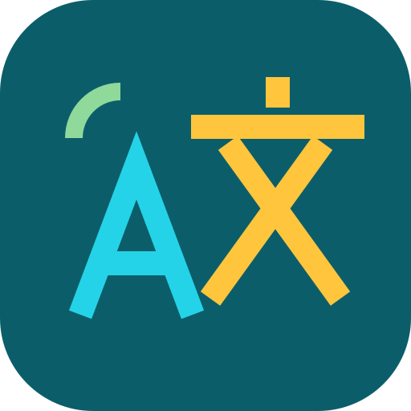
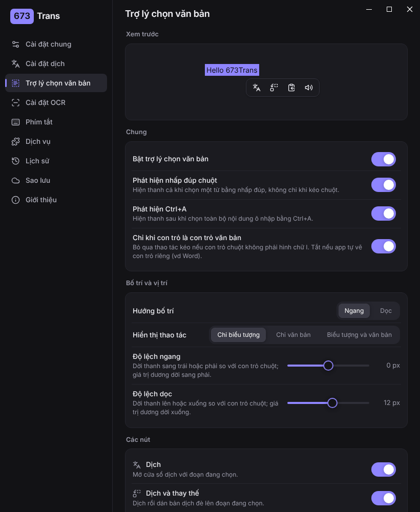
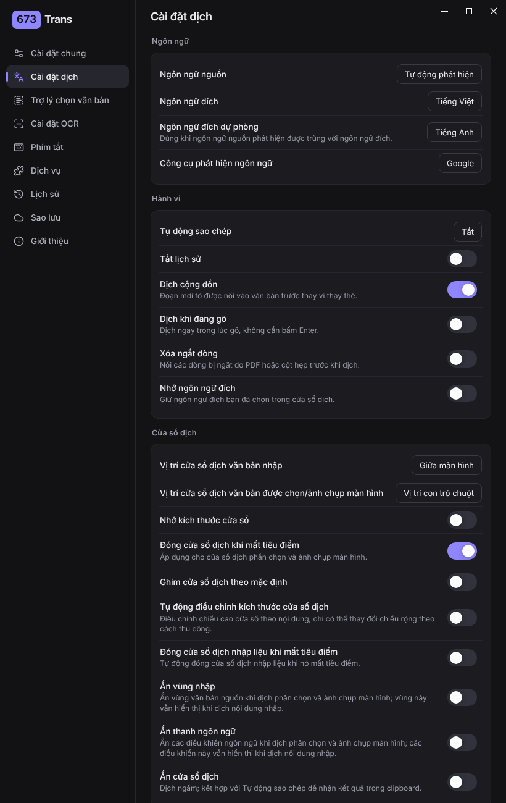
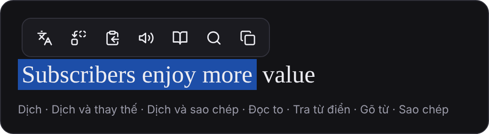
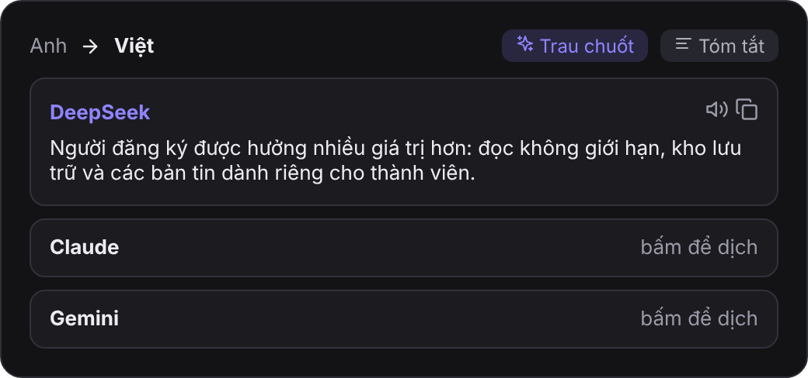
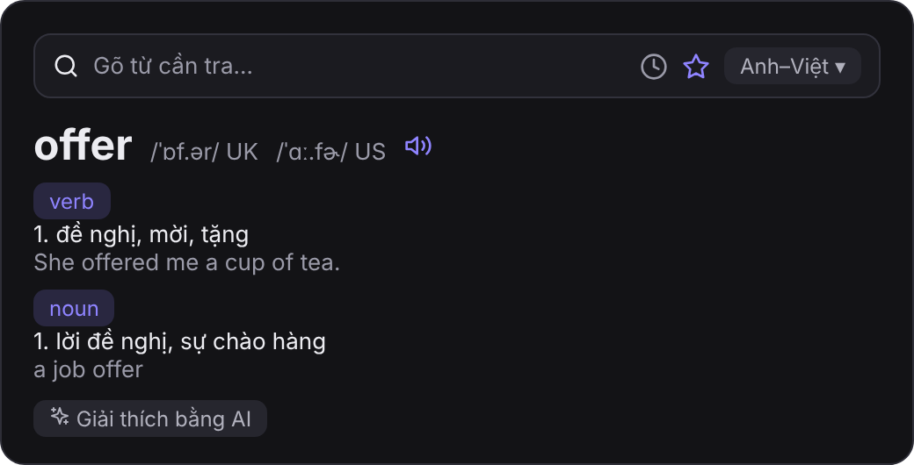
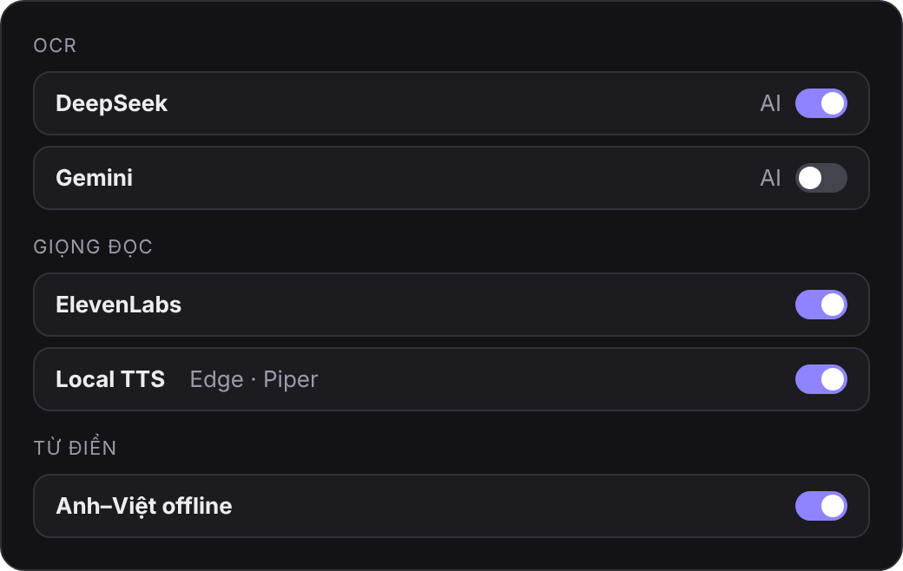
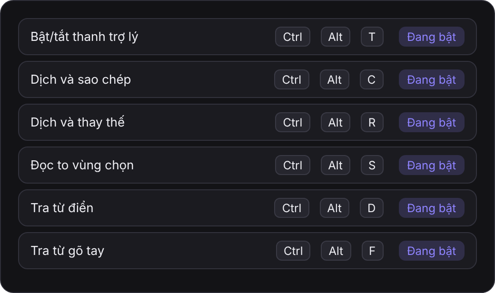
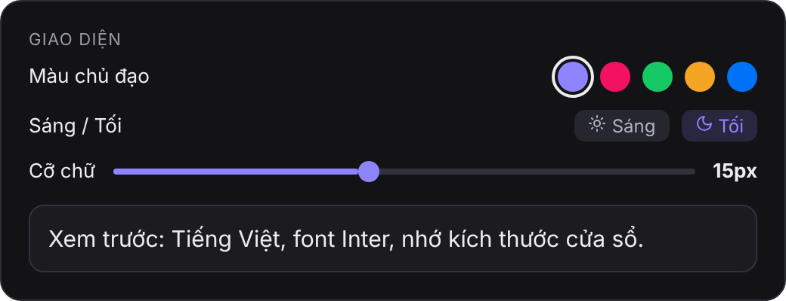
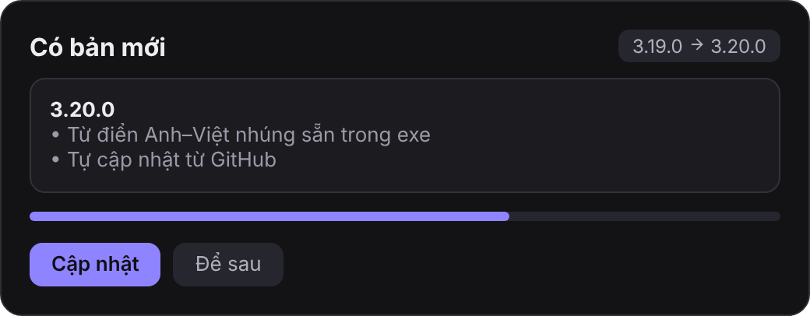

# 673Trans

>Trình dịch chọn-là-dịch cho Windows: giao diện tiếng Anh/Việt gọn hiện đại, Sử dụng nhiều dịch mặc định như Google, Bing và các dịch vụ tích hợp bằng AI (DeepSeek, Claude, GPT, Gemini...), Có sẵn từ điển Anh–Việt, voice US/UL, OCR và giọng đọc AI, thanh icon nổi khi bôi đen chữ ở bất kỳ app nào có khả năng dịch, viết lại, chữa chính tả, đọc, tra từ điển, bookmark...


<br/>
<hr/>

<table>
<tr>
    <td> 
    <td> 
</table>

## Tính năng

**Thanh icon nổi khi chọn chữ**



- Hiện cạnh con trỏ khi bôi đen chữ, nhấp đúp một từ, hoặc bấm Ctrl+A trong ô nhập, ở bất kỳ app nào.
- 7 nút bật/tắt được: Dịch, Dịch và thay thế (dán bản dịch đè lên đoạn đang chọn), Dịch và sao chép, Đọc to, Tra từ điển, Gõ từ, Sao chép.
- Kéo thả đổi thứ tự nút; ngang/dọc; chỉ icon, chỉ chữ hoặc cả hai; độ lệch; danh sách app không hiện thanh; có ô xem trước.

**Dịch bằng AI**



- Có sẵn DeepSeek, Claude, GPT, Gemini và "Tương thích OpenAI" (OpenRouter, Qwen, Kimi, SiliconFlow, LM Studio…).
- Nút **Trau chuốt**, **Viết lại, chính tả** và **Tóm tắt** ngay trong cửa sổ dịch.
- Công tắc nguồn cho từng dịch vụ: tắt thì chỉ dịch khi bạn mở thẻ của nó.

**Từ điển** (tô một từ, bấm icon quyển sách hoặc dùng phím tắt)



- Popup kiểu Cambridge hiện cạnh con trỏ, có IPA UK/US và giọng đọc.
- 3 từ điển, đổi bằng menu: **Anh–Việt offline** (103k từ, **đã nhúng sẵn trong exe**, tra ngược Việt → Anh, gợi ý từ gần giống), **Wiktionary** (giọng ghi âm thật, định nghĩa, câu ví dụ, lưu đệm), **Từ điển AI** (chọn hãng DeepSeek, OpenAI, Claude, Gemini hoặc tương thích OpenAI, nhập khoá API riêng).
- ⭐ lưu từ vào sổ từ vựng, 🕘 lịch sử tra từ, ô gõ từ (có phím tắt riêng), nút "Giải thích bằng AI" chạy khi bấm.
- Nhớ kích thước popup; tuỳ chọn đọc giọng US bằng TTS.

**OCR và giọng đọc**



- Có sẵn và bật sẵn: OCR của Windows (System) và **Tesseract** (dữ liệu tiếng Anh, Việt, Trung đã nhúng trong exe, chạy offline).
- OCR bằng AI: DeepSeek, Gemini, GPT, Claude, tương thích OpenAI.
- Giọng đọc: ElevenLabs, OpenAI TTS, Gemini TTS, và **Local TTS**: giọng Edge neural **có sẵn trong exe** (cần mạng, không cần cài gì); ai có server riêng thì dùng thêm Piper offline và kho audio người thật.

**Dịch vụ và phím tắt**



- Công tắc bật/tắt cho mọi dịch vụ (dịch, OCR, giọng nói, từ điển, sổ từ vựng) mà không cần xoá.
- Trang Phím tắt: bật/tắt tất cả, bật/tắt thanh trợ lý, dịch+chép, dịch+thay thế, đọc to vùng chọn, OCR+chép, dịch ảnh+chép, đổi cặp ngôn ngữ đích, tra từ điển, tra từ gõ tay.

**Cửa sổ dịch**
- Vị trí riêng cho chữ nhập và chữ chọn/ảnh chụp, ẩn vùng nhập hoặc thanh ngôn ngữ, tự chỉnh chiều cao, ghim mặc định, đóng khi mất tiêu điểm, có ô xem trước.

**Giao diện**



- Tiếng Việt, font Inter có sẵn, màu chủ đạo chọn được, sáng/tối, cỡ chữ kéo theo từng px, nhớ kích thước cửa sổ.

**Tự cập nhật**



- Khi mở app, tự kiểm tra bản mới trên [Releases](https://github.com/nguyenguyen673/673Trans/releases); bấm Cập nhật là tự tải, thay file và mở lại.

Chỉ cần file `.exe` để chạy (Windows 10/11 có WebView2). Wiktionary và các dịch vụ AI cần internet; dịch vụ AI cần khoá API của bạn.

## Cài đặt và build

Cần Node.js 18+, pnpm, Rust, và Visual Studio Build Tools (Desktop development with C++).

```
pnpm install
pnpm tauri dev      # chạy thử
pnpm tauri build    # ra bản cài đặt
```

Hướng dẫn chi tiết, chỗ sửa từng phần của giao diện và cách tự thêm hãng AI: xem [HUONG-DAN.md](HUONG-DAN.md).

## Ghi công và giấy phép

673Trans là bản fork của [Pot](https://github.com/pot-app/pot-desktop) 3.0.7 (dự án gốc đã ngừng cập nhật), giữ nguyên giấy phép [GPL-3.0](LICENSE). Cảm ơn tác giả và những người đóng góp cho Pot. Bản này dùng chung cấu hình và plugin với Pot nên **không chạy cùng lúc với Pot**.

Dữ liệu từ điển Anh–Việt offline là của [Dự án Từ điển tiếng Việt miễn phí](https://www.informatik.uni-leipzig.de/~duc/Dict/) (Hồ Ngọc Đức); Wiktionary thuộc Wikimedia Foundation, nội dung theo CC BY-SA, dữ liệu trích qua [kaikki.org](https://kaikki.org).
